# Digital Portfolio #

**Student Number:** 221212779    
**Module:** PRP370S - Project Presentation 3  
**Qualification:** Diploma in ICT Communication Networks  
**Institution:** Cape Peninsula University of Technology (CPUT)  
**Year:** 2026

---

## Curriculum Vitae

### Professional Summary

ICT in Communication Networks student with practical experience in configuring, maintaining and troubleshooting network systems. Skilled in TCP/IP, routing, switching, VLANs, DHCP and basic network security. Seeking an opportunity in any network related IT role to apply technical skills, gain hands-on industry exposure and contribute to reliable and secure communication networks.

### Contact

- Phone: 0633284592
- Email: 221212779@mycput.ac.za
- Address: Cape Town, Western Cape, South Africa

### Technical Skills

- LAN/WAN configuration, routing & switching
- VLANs and IP addressing
- Network security and proactive monitoring
- Hardware/software installation and maintenance (Windows & Linux)
- Network labs and troubleshooting exercises (CPUT)
- GitHub and Markdown
- Problem solving and communication

### Education

**Matric**  
Executive Academy  
Passed with National Senior Certificate

**Diploma in ICT Communication Networks (In Progress)**  
Cape Peninsula University of Technology (CPUT), Cape Town  
Expected completion: 2026

---

### References

**Martin Mndioma**  
Lecturer  
Cape Peninsula University of Technology  
Phone: (021) 460-3675  
Email: mandiomam@cput.ac.za

---

**Bongiwe Ntwasa**  
Peer/Colleague  
Cape Peninsula University of Technology  
Phone: 073-847-7582  
Email: 221573183@mycput.ac.za

---

## 🎥 Mock Interview Video

<iframe 
  width="560" 
  height="315" 
  src="https://www.youtube.com/embed/TBtgkpgWZFE" 
  title="Mock Interview Video" 
  frameborder="0" 
  allow="accelerometer; autoplay; clipboard-write; encrypted-media; gyroscope; picture-in-picture" 
  allowfullscreen>
</iframe>

*Watch my mock interview practice session*

**Direct Link:** [Watch on YouTube](https://youtu.be/TBtgkpgWZFE)

---

## 📝 Reflections

### Reflection 1: Coding in Markdown (STAR Method)

**Situation**  
I was required to create a digital portfolio using GitHub and Markdown language for the PRP370S module.

**Task**  
I needed to design and develop a complete digital portfolio, including a CV and reflections, using Markdown syntax.

**Action**  
I researched GitHub Flavoured Markdown (GFM) documentation, practiced with headings, lists, tables, and links, and structured my portfolio content clearly. I used tables for my education and skills sections to present information neatly.

**Result**  
I successfully created a professional digital portfolio and gained practical skills in Markdown. My CV is now version-controlled and accessible online.

---

### Reflection 2: Mock Interview Video (STAR Method)

**Situation**  
As part of work readiness training, I was required to record a mock interview video.

**Task**  
I needed to answer common interview questions confidently and demonstrate professional communication skills.

**Action**  
I researched common ICT interview questions, prepared STAR-based answers, practiced my responses, recorded multiple takes, and selected the best one to embed in my portfolio.

**Result**  
I created a professional interview video, improved my confidence, reduced filler words, and added a valuable visual element to my portfolio.

---

### Reflection 3: Using GitHub Pages (STAR Method)

**Situation**  
I needed to publish my Markdown portfolio online so that examiners could access it.

**Task**  
I had to enable GitHub Pages, configure deployment settings, and ensure the portfolio was publicly accessible.

**Action**  
I went to Settings → Pages, selected the `main` branch, chose `/ (root)` as the folder, clicked Save, and waited 2-3 minutes for deployment.

**Result**  
I successfully published my portfolio online at [https://sikhutazejoseph.github.io](https://sikhutazejoseph.github.io) and learned how to host websites using GitHub Pages for free.

---

## Contact

- GitHub: [github.com/sikhutazejoseph](https://github.com/sikhutazejoseph)
- Email: 221212779@mycput.ac.za
- Portfolio: [sikhutazejoseph.github.io](https://sikhutazejoseph.github.io)

---

 

 

 ## 👥 The Agile Team
 
**Project Name:** Ekhaya Connect - Affordable WISP

**Module:** PRP371S - Entrepreneurial WIL Project

## 🌐 Project Overview
**The Problem:** Khayelitsha faces a severe digital divide due to major telecom companies under-investing in the area. Residents and small business owners struggle daily with a lack of affordable, reliable home internet.
**Our Solution:** *Ekhaya Connect* is a Wireless Internet Service Provider (WISP) offering uncapped 10 Mbps fixed wireless internet for approximately R399/month.

## 👥 The Agile Team
*   **Sikhutaze Joseph**
*   Bongiwe Ntwasa
*   Elam Mthwane
*   Phumelela Nzewu
*   Lilitha Nodolo

---

### 1. Agile Team Charter
**Evidence:** We defined our shared vision, scope, and working agreements. We also validated our idea by interviewing 17 households (82% were willing to pay).
**Reflection:** Honestly, before doing the charter, I thought it was just unnecessary paperwork. But sitting down and agreeing on our rules (like using Trello and raising blockers immediately) actually saved us a lot of arguments later. My part was helping with the community interviews. Talking to those 17 households in Khayelitsha showed me that our idea wasn't just a school project—people actually need this.

### 2. User Stories and Tasks
**Evidence:** We broke down our WISP features into user-centric stories (e.g., "As a resident, I want reliable internet...") and split them into actionable tasks on our Trello board.
**Reflection:** Writing user stories was surprisingly hard at first. I kept thinking like a developer instead of a customer. Once I got the hang of it, it made things way easier. My role was taking our research and turning it into tasks on Trello. Seeing the huge goal of "build a WISP" broken into small, doable tasks made the whole thing feel way less overwhelming.

### 3. Product Backlog & Sprint Backlog
**Evidence:** We prioritized tasks on our Trello board (see screenshot below) and executed them across 4 Sprints. 
**Reflection:** This taught me a harsh lesson in time management. We had so many ideas, but we had to be realistic about what we could actually finish. My role was keeping my assigned cards updated and adding descriptions so the team knew what I was doing. I realized it's better to completely finish a few tasks than to have ten tasks stuck in "In Progress."

---

## 📸 Visual Evidence

### Trello Board (Product & Sprint Backlogs)

**Reflection on Trello Evidence:** Using Trello was a bit of an adjustment for our team. At first, we weren't using it properly, but it became our main workspace. My role was keeping my specific cards updated and moving them across the board. It was actually really satisfying seeing the "Completed" column fill up. It showed me how important visual tracking is so the whole team knows exactly where we stand.

### 4. Agile Logbook
**Evidence:** We tracked our daily standups and bottlenecks from July 21st onwards (see screenshots below).
**Reflection:** Writing these standups every day felt a bit tedious, but looking back, it was the best thing we did. My role was updating the log and helping my teammates who were struggling with Trello at first. It taught me that Agile is basically just good communication. When we admitted our blockers in the logbook, we could actually fix them together instead of stressing alone.

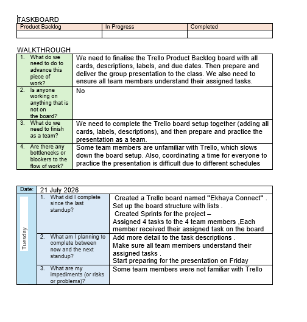

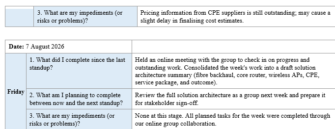
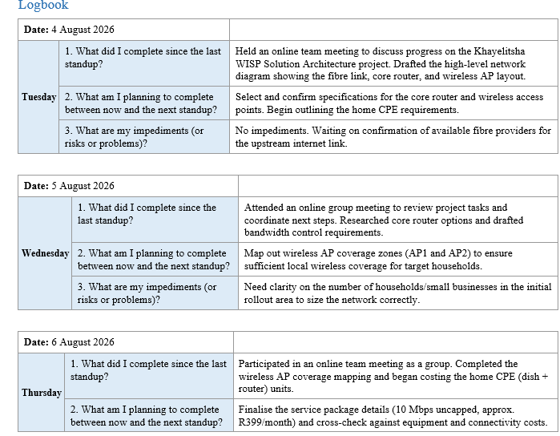
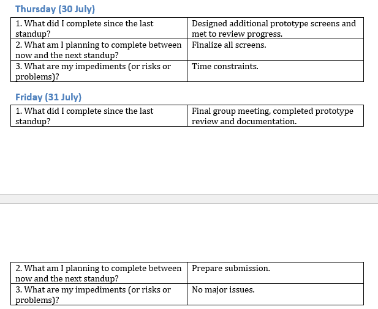
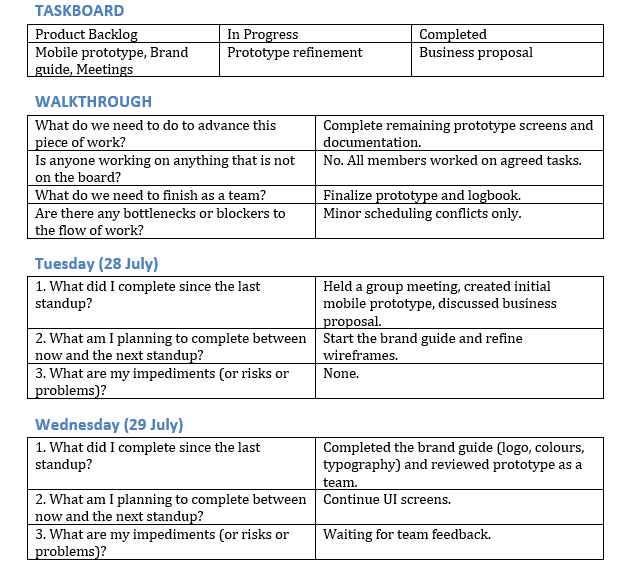

**Reflection on Logbook Evidence:** Looking at these screenshots now, I can see how we evolved. We started off a bit confused (the first log shows we were unsure about Trello), but by the end, we were confident and ready to present. Keeping this log held us accountable and proved to me that reflection isn't just looking back—it's actually how you improve as a team.

---

## 🎨 Project Deliverables 

### 1. The Live Website
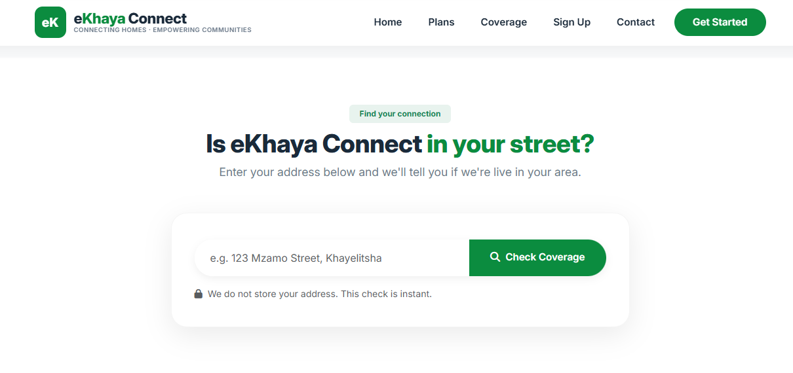
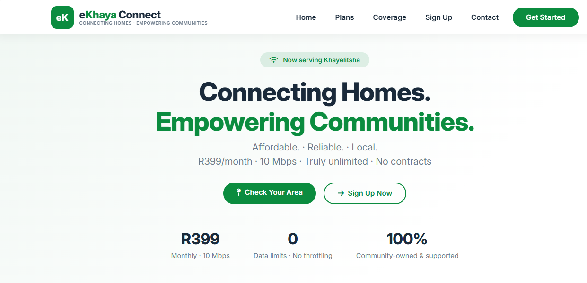
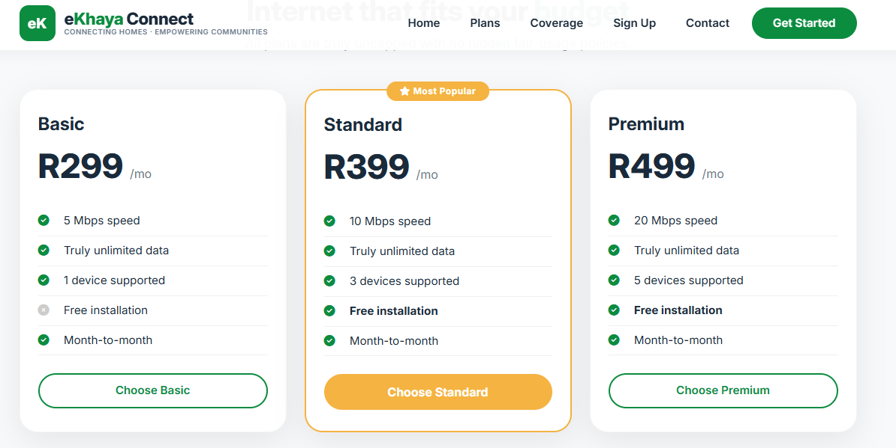

### 2. UI/UX Wireframes
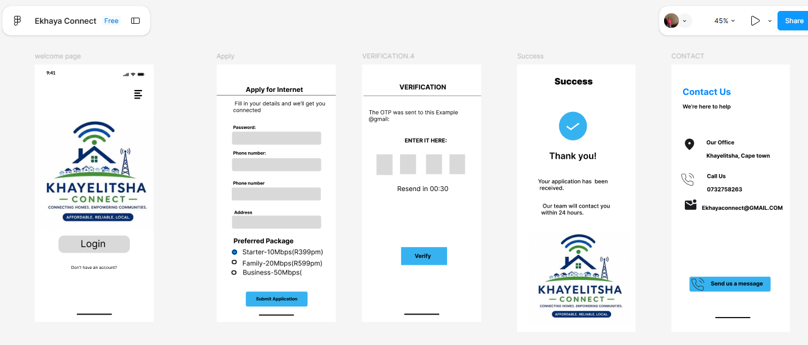

### 3. Business Model Canvas

### 4. Solution Architecture

### 5. Brand Guide
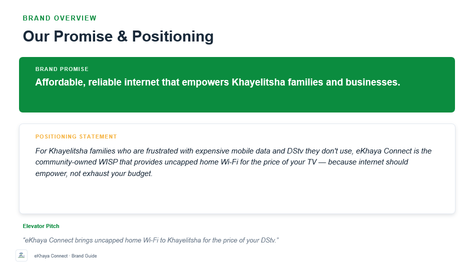
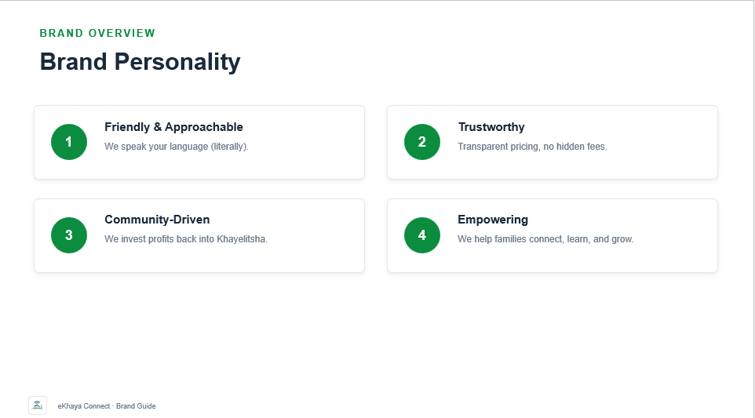
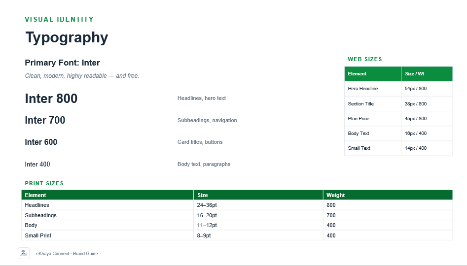
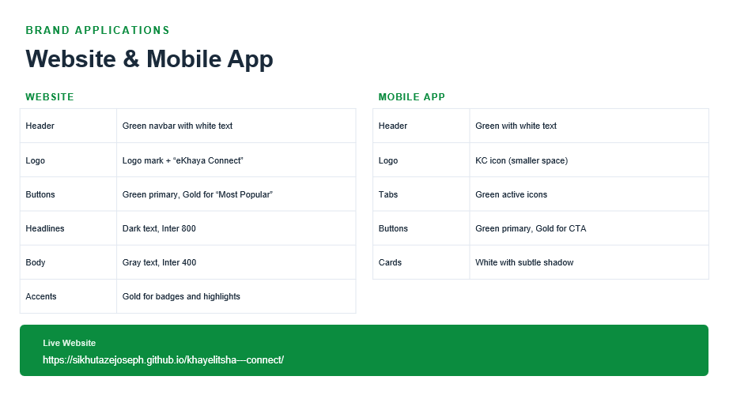
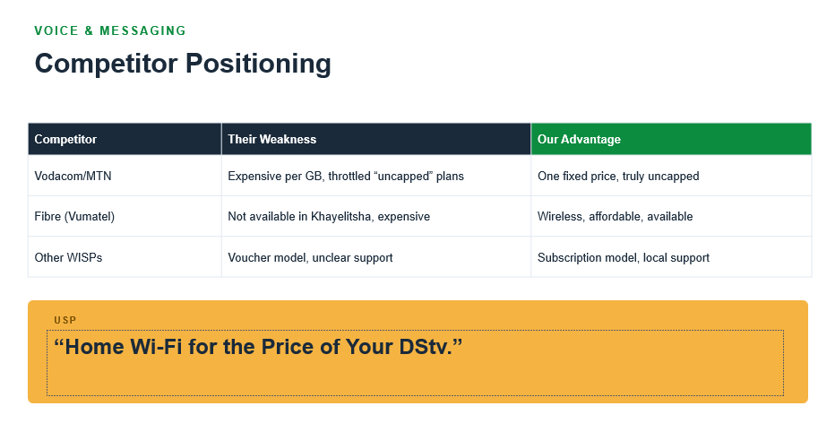
 
